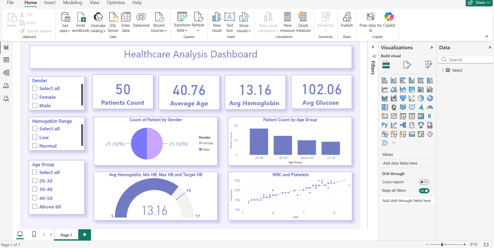

[README.md](https://github.com/user-attachments/files/33286341/README.md)
# 🏥 Healthcare Data Analysis Dashboard – Power BI

## 📌 Project Overview

This project focuses on analyzing healthcare data using Microsoft Power BI to transform raw data into meaningful insights through interactive dashboards and visualizations.

The dashboard helps users explore healthcare data, identify patterns, and understand key metrics to support data-driven decision-making.

## 🎯 Objectives

- Analyze healthcare data using interactive visualizations.
- Identify trends and patterns in the dataset.
- Present key healthcare metrics through a dashboard.
- Support better understanding of healthcare data through visual analytics.

## 🛠️ Tools & Technologies

- **Microsoft Power BI** – Dashboard development and data visualization
- **Power Query** – Data cleaning and transformation
- **DAX** – Calculated measures and metrics, if applicable
- **Data Visualization** – Charts, graphs, and interactive reports

## 📊 Key Features

- Interactive dashboard for healthcare data analysis.
- Visual representation of important metrics.
- Charts and graphs to explore data patterns.
- Filter-based data exploration, where implemented.
- Easy-to-understand presentation of analytical findings.

## 📸 Dashboard Preview

## 📁 Project Files

| File Name | Description |
|---|---|
| `healthcare_analysis_.pbix` | Power BI dashboard project file |
| `README.md` | Project documentation |

## 🚀 How to Use

1. Download the `healthcare_analysis_.pbix` file from this repository.
2. Install Microsoft Power BI Desktop.
3. Open the downloaded `.pbix` file in Power BI Desktop.
4. Explore the dashboard and available report interactions.

## 💡 Skills Demonstrated

- Data Analysis
- Data Visualization
- Power BI Dashboard Development
- Data Cleaning and Transformation
- Analytical Thinking
- Business Intelligence

## 👩‍💻 Author

**Varshini V**  
Aspiring Data Analyst
